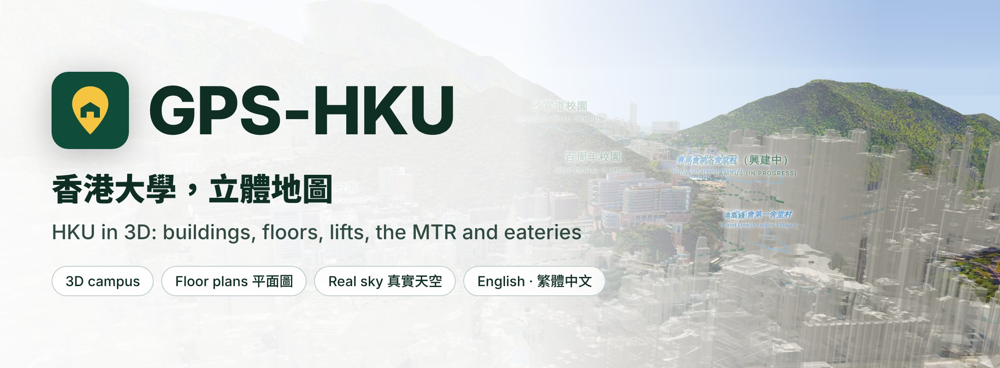
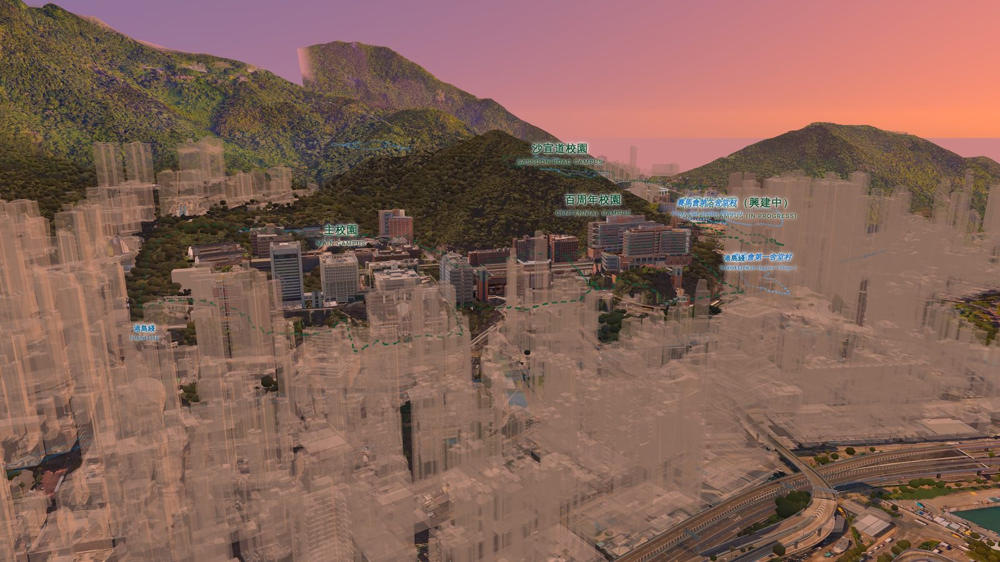
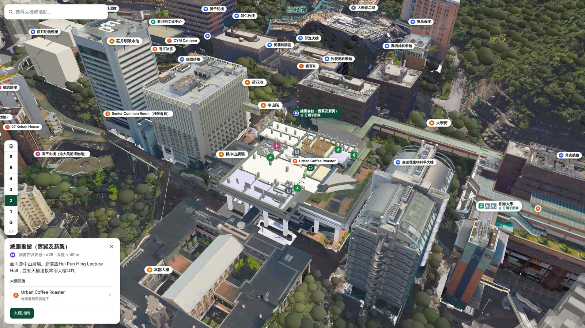
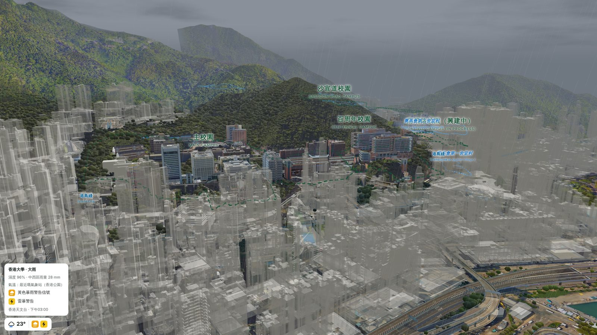
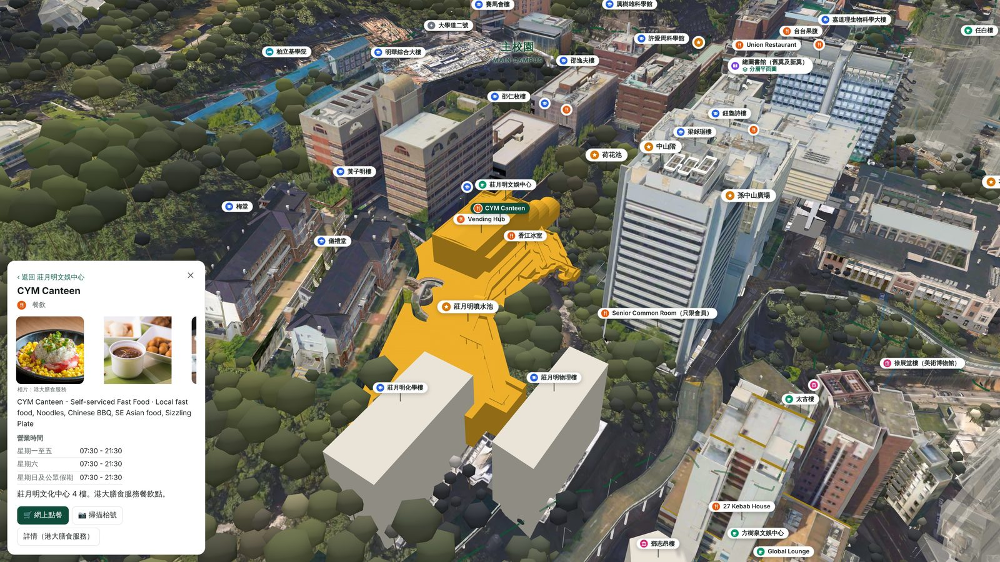
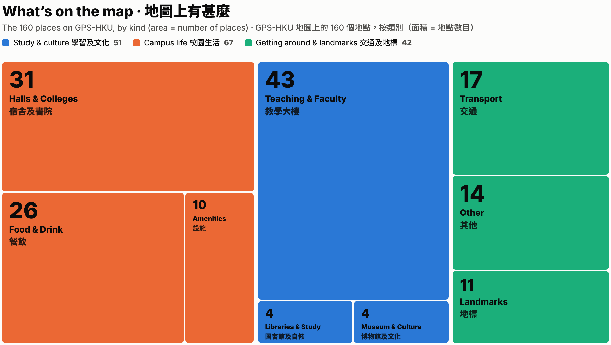

<p align="center">
  <picture>
    <source media="(prefers-color-scheme: dark)" srcset="docs/images/banner-dark.jpg" />
    <source media="(prefers-color-scheme: light)" srcset="docs/images/banner-light.jpg" />
    
  </picture>
</p>

<h1 align="center">GPS-HKU</h1>

<p align="center">
  <a href="README.md">English</a> |
  <strong>繁體中文</strong>
</p>

<p align="center">
  <a href="https://icebays.github.io/gps-hku/"></a>
  <a href="https://github.com/icebays/gps-hku/discussions"></a>
  <a href="https://github.com/icebays/gps-hku/wiki"></a>
</p>

<p align="center">
  <a href="LICENSE"></a>
  <a href="https://threejs.org/"></a>
  
  <a href="https://github.com/icebays/gps-hku/commits/main"></a>
</p>

<p align="center">
  <a href="https://icebays.github.io/gps-hku/"></a>
</p>

GPS-HKU 是香港大學的 3D 地圖、步行及平面圖指南。它以地政總署的測量數據，按真實比例呈現依山而建的港大校園，讓你一眼看清哪一層才是地面、天橋通往哪裏、哪部升降機能帶你上山。

無需安裝程式、無需登入，手機或電腦的瀏覽器都可使用，提供英文及繁體中文。

## 快速開始

開啟 **https://icebays.github.io/gps-hku/** ，試試：

1. **找大樓**：在搜尋框輸入 `總圖書館` 或 `Main Library`（或按 `/`），地圖會飛到該處並以金色標示。
2. **看內部**：在左邊的樓層選擇器選 **2**，大樓會在 2 樓剖開。
3. **看實景**：開啟 **圖層** 並選 **衛星**，天空會跟隨真實太陽及天文台天氣。
4. **找自己**：按 🎯 顯示你的位置及面向。

在自己的電腦運行（純靜態網站，無需建置）：

```bash
python3 -m http.server 8000   # 然後開啟 http://localhost:8000
```

## 宣傳片

https://github.com/user-attachments/assets/64d3104e-427e-4a7b-9d8e-738cbeb77997

<p align="center">
  <sub>影片於網站實機拍攝；天氣鏡頭中的暴雨及雷暴警告為示範資料，並非當日真實天氣。原創配樂，音效來自 <a href="https://mixkit.co/license/#sfxFree">Mixkit</a>。</sub>
</p>

## 功能展示

<p align="center">
  
</p>
<p align="center"><sub>日落時的衛星模式：天空跟隨太陽於港大上空的真實位置，天色照在建築及地面上。</sub></p>

<p align="center">
  
</p>
<p align="center"><sub>總圖書館於 2 樓剖開，附資料卡及樓層選擇器。</sub></p>

<p align="center">
  
</p>
<p align="center"><sub>衛星地圖上的暴雨，天氣小工具顯示香港天文台的警告（示範資料）。</sub></p>

<p align="center">
  
</p>
<p align="center"><sub>CYM Canteen 的資料卡：相片、營業時間、網上點餐及掃描枱號。</sub></p>

<p align="center">
  
</p>
<p align="center"><sub>深藏山底的港鐵香港大學站月台，以 X 光方式透過深色地圖顯示。</sub></p>

## 為甚麼要有 GPS-HKU

港大依山而建。一座大樓的「地下」可能比隔壁高出或低出好幾層；舊主校園與百周年校園之間靠天橋、平台、升降機塔及上下兩層的大學街連接；港鐵站更深藏山底。一張平面地圖表達不到這些，GPS-HKU 以 3D 按真實比例呈現。

## 地圖上有甚麼

<picture>
  <source media="(prefers-color-scheme: dark)" srcset="docs/images/treemap-dark.png" />
  
</picture>

<details>
<summary>以表格顯示數字</summary>

| 組別 | 類別 | 地點數目 |
|---|---|---:|
| 校園生活 | 宿舍及書院 | 31 |
| 校園生活 | 餐飲 | 26 |
| 校園生活 | 設施 | 10 |
| 學習及文化 | 教學大樓 | 43 |
| 學習及文化 | 圖書館及自修 | 4 |
| 學習及文化 | 博物館及文化 | 4 |
| 交通及地標 | 交通 | 17 |
| 交通及地標 | 其他 | 14 |
| 交通及地標 | 地標 | 11 |
| | **合計** | **160** |

</details>

## 功能

| | |
|---|---|
| **3D 校園** | 主校園、百周年校園、沙宣道校園、蒲飛路校園（興建中）、各宿舍及周邊街道，像 Google Earth 一樣逐塊載入。港大建築以實體顯示，其他建築半透明。高度以主水平基準以上米數（mPD）標示。 |
| **三種外觀** | 簡潔的**地圖**（地勢陰影、每 10 米等高線、道路、行人路、路面標記）、**深色模式**（深色地面配灰色建築）及**衛星**（航空照片、附相片紋理的港大建築、相片路面、立體樹冠）。 |
| **真實天空** | 衛星模式下：日間藍天、金黃時刻、日落、藍調時刻及夜晚，跟隨太陽的真實位置；雲及雨跟隨天文台即時天氣，雨勢按過去一小時雨量。天色會照在建築及地面上。 |
| **太陽及天氣** | 即時太陽位置及柔和影子。天氣小工具顯示氣溫、濕度、本區雨量及所有生效中的天文台警告（熱帶氣旋、暴雨、雷暴、酷熱或寒冷天氣、季候風、火災危險、山泥傾瀉、水浸、霜凍、海嘯），每 10 分鐘更新。 |
| **160 個地點** | 港大官方校園地圖上的所有建築，以及圖書館、宿舍、餐廳、港鐵出口及地標。校園及宿舍群以框線圈出並標示名稱。可用中英文名稱或校園地圖編號搜尋。 |
| **3D 樓層平面圖** | **總圖書館**（G 至 6 樓）、**百周年校園**平台（CPD LG 至 4 樓，附每個課室的編號及座位數）及港鐵**香港大學站**、**西營盤站**、**堅尼地城站**。選擇樓層後，建築會在該層以上剖開；車站以 X 光方式透過淡化的地圖顯示。 |
| **港鐵** | 每個出口按港鐵指示牌標示出口編號；港島綫按路軌的真實深度繪出。 |
| **26 間餐廳** | 港大膳食服務的餐廳、飯堂及咖啡店，附相片、食物種類、營業時間及詳情。其中 14 間提供網上點餐（開啟餐廳自己的點餐頁面）；**掃描枱號**以手機相機開啟你那張枱的點餐頁面。 |
| **你的位置** | 以平放在地面的藍點顯示 GPS 位置，並有隨你面向而轉動的光束。位置資料不會離開你的手機。 |
| **指南** | 前往港大的方法、上下大學街、升降機及無障礙路線、建築目錄、樓層平面圖、步行路線及地圖操作，中英對照。 |
| **分享視角** | 網址會跟隨你正在看的地方（`#/zh/map?place=main-library&floor=2`），分享連結即可開啟同一地點及樓層。 |
| **手機優先** | 支援 Google / Apple 地圖手勢（拖動、雙指縮放、旋轉、雙指傾斜、雙擊放大），並為 iPhone 控制記憶體用量。 |

## 地圖操作

| 動作 | 滑鼠 | 觸控 |
|---|---|---|
| 移動 | 左鍵拖動 | 單指拖動 |
| 旋轉／傾斜 | 右鍵拖動（或 Ctrl + 拖動） | 雙指扭動旋轉；雙指一同向上或向下推以傾斜 |
| 縮放 | 滾輪 | 雙指開合，或雙擊後按住再拖動；雙擊放大 |
| 選擇建築 | 點擊 | 輕按 |

| 按鈕 | 功能 |
|---|---|
| 🧭 指南針 | 北向上；再按一次面向南 |
| ↺ 重設 | 返回起始視角，如港大校園地圖般面向南 |
| ◇ 平面／3D | 由上而下的「平面圖」視角或傾斜 3D 視角 |
| 🎯 位置 | 你的 GPS 位置及面向 |
| ⤴ 路線 | 步行路線 |
| 圖層 | 地圖、地圖加真實建築或衛星 |
| 篩選 | 顯示或隱藏地點類別 |
| ☾（頂欄） | 淺色或深色模式 |

## 技術架構

GPS-HKU 是純靜態網站：原生 JavaScript 模組及 [three.js](https://threejs.org/)，無框架、無需建置，以 GitHub Pages 發佈。3D 校園切成分塊，按視角附近逐塊載入；分塊、相片模型及地圖資料均由 `tools/` 內的腳本離線由原始數據製作。

| | |
|---|---|
| `index.html`、`assets/` | 網站：`app.js`（頁面）、`map.js`（3D 地圖）、`tiles.js`（分塊載入）、`indoor.js`（平面圖）、`sky.js`（衛星模式天空）、`roads.js`、`icons.js`、`weather.js` |
| `content/en`、`content/zh` | 指南頁面（Markdown） |
| `data/places.json` | 地點：建築、餐廳、港鐵出口及其模型建築編號 |
| `data/campus.json` | 校園及宿舍群範圍、港大建築 |
| `data/indoor/` | 樓層平面圖 |
| `data/eateries.json`、`data/mtr-lines.json`、`data/routes.json` | 餐廳資料、港鐵綫、步行路線 |
| `assets/tiles/`、`assets/model/` | 3D 分塊及模型 |
| `tools/` | 以上各項如何由原始數據製作（見 `tools/README.md`） |
| `vendor/` | three.js、marked、jsQR（瀏覽器沒有內置 QR 讀取時用於掃描枱號） |
| `docs/`、`promo/` | README 圖片、宣傳片 |

網站模組更新時，請同時更新 `index.html` import map 內的 `?v=` 版本號，避免手機混用新舊檔案。

## 資料來源

- 三維空間數據及三維室內地圖（IMDF）© 香港特別行政區政府地政總署
- 建築及地點：港大校園地圖（maps.hku.hk）；餐廳：港大膳食服務（catering.hku.hk），相片連結自該網站
- 樓層平面圖：按港大圖書館平面圖及港大考試處 CPD 課室平面圖重繪
- 港鐵出口及路綫、道路及小徑：© OpenStreetMap 貢獻者（ODbL）
- 天氣及警告：香港天文台
- QR 讀取：[jsQR](https://github.com/cozmo/jsQR)（Apache-2.0）

## 項目範圍

- GPS-HKU 為非官方學生項目，與香港大學及香港鐵路有限公司並無關連。重要資訊（營業時間、無障礙設施、關閉安排）請以官方資料為準。
- 網站只由維護者編輯，不設公開編輯。
- 步行路線由維護者實地走過後才加入，目前尚未發佈。
- 網上點餐會開啟各餐廳自己的點餐頁面；GPS-HKU 本身不接受點餐或付款。
- 部分地點標有 ⚠︎，表示位置為估計，待確認。

## 社群

- 提問、建議及更正：[Discussions](https://github.com/icebays/gps-hku/discussions)
- 更多說明：[Wiki](https://github.com/icebays/gps-hku/wiki)
- 申請使用 GPS-HKU 任何部分：開一個 [issue](https://github.com/icebays/gps-hku/issues)

## Star 歷史

<picture>
  <source media="(prefers-color-scheme: dark)" srcset="https://api.star-history.com/svg?repos=icebays/gps-hku&type=Date&theme=dark" />
  
</picture>

## 版權

© 2026 icebays。版權所有，保留一切權利。GPS-HKU 並非開源項目：未經本人事先書面許可，不得複製、修改、分發或使用本項目任何部分，亦不允許商業用途。使用前請先透過
[issue](https://github.com/icebays/gps-hku/issues) 查詢。第三方材料保留其原有條款。詳見 [LICENSE](LICENSE)。
